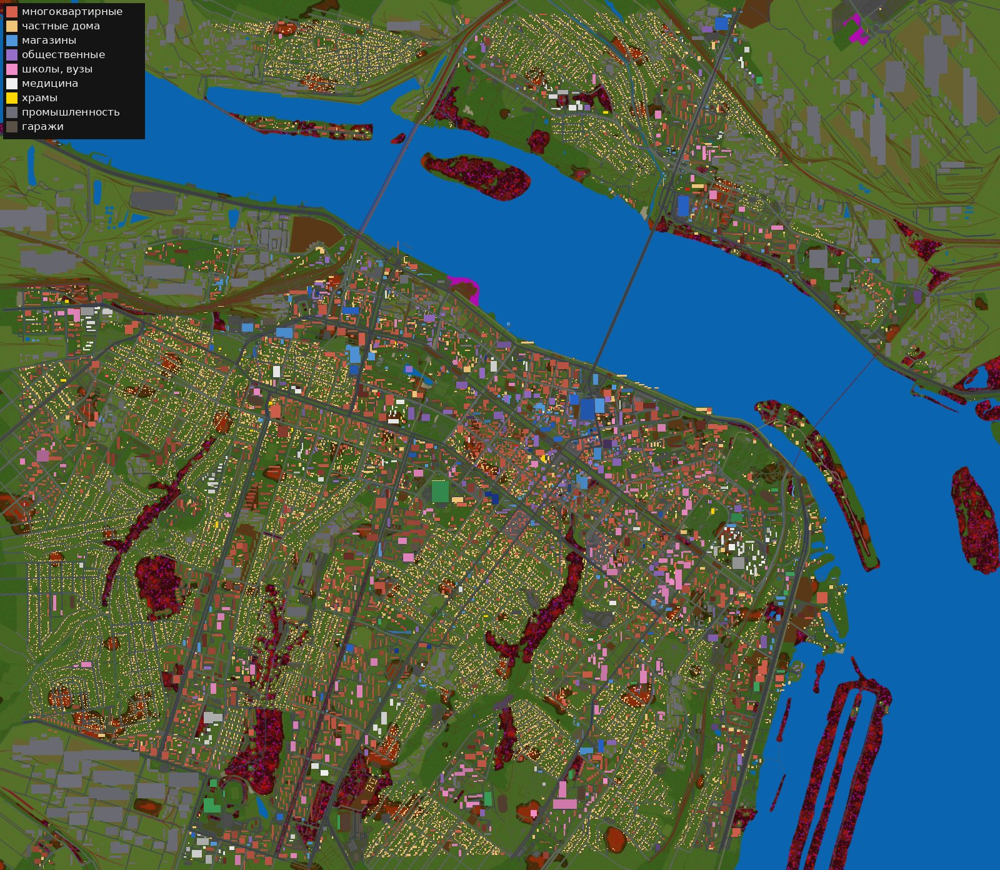
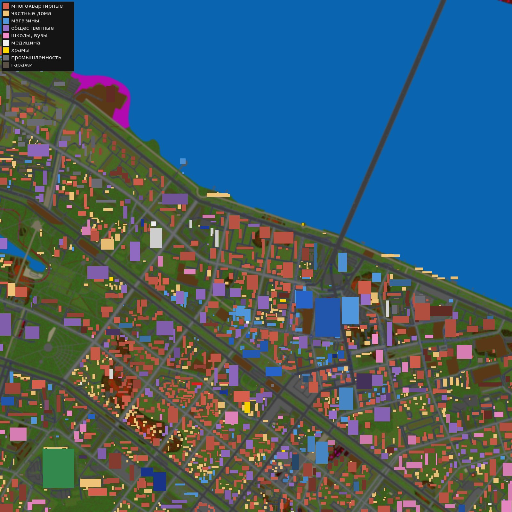
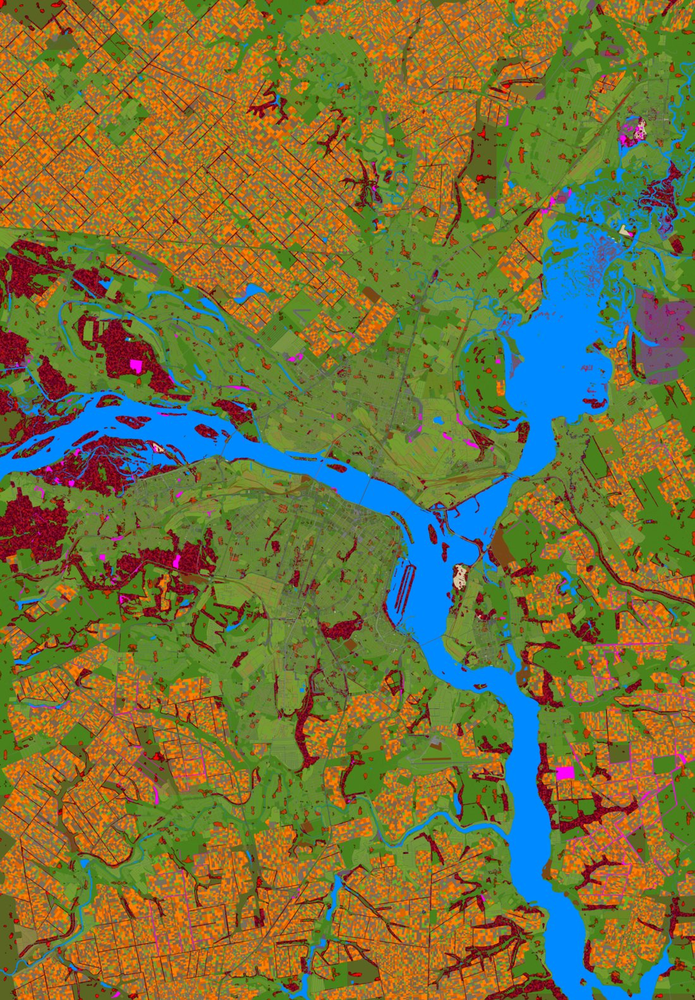

# Дніпро для Project Zomboid (Build 42)

Карта города **Днепр** и его окрестностей для Project Zomboid B42, сделанная генератором
[KnoxMap](https://github.com/spytheeuclidean-a11y/knoxmap) из реальных данных
OpenStreetMap, с доработками под украинскую застройку.

Область — всё, что видно на скриншоте Google Maps: от **Чумаков / Степового / Спасского**
на севере до **Волоського / Новоолександрівки / Новомиколаївки** на юге, от **Обухівки /
Горянівського** на западе до **Самара / Новоселівки / Олександрівки** на востоке.
Это прямоугольник 48.260–48.685 с.ш., 34.825–35.262 в.д. — примерно **32 × 47 км (~1500 км²)**.

Масштаб **1 тайл = 1 метр** (реальный размер), каждое здание из OSM на своём реальном
контуре, реальная этажность, реальные улицы.

## Что сделано

**Данные — свежие (OpenStreetMap от 19.11.2026)**, то есть состояние города 2022–2026:
новые названия улиц после декоммунизации, Самар вместо Новомосковска, новые ЖК
(Sun Tower, Sky Tower, Grand Tower, Мост-Сити, Башни и т.д.).

- `data/dnipro_area_fixed.osm.pbf` — готовая выгрузка района (19 МБ), собрана из 6 областей
  (`scripts/prepare_data.sh`), чтобы полигон Днепровского водохранилища был целым.
- Исправлены ошибки самих данных OSM (`scripts/fix_osm.py`):
  - у отношения «Дніпровське водосховище» стоял тег `highway=residential` — из-за него весь
    Днепр рисовался **асфальтом** вместо воды;
  - этажность знаковых зданий, которой нет в OSM: готель «Парус» (28 эт. высотной части,
    всего 32; убран внешний контур подиума, который «съедал» башню), центр «Менора» (20), вокзал Дніпро-Головний (4), ТЦ «Мост-Сити» (5),
    Спасо-Преображенский собор (в OSM высота 0.01 м), терминал аэропорта.

**Названия — на русском**: где в OSM есть русское название (`name:ru`) — оно (≈11,7 тыс.
объектов: половина улиц, почти все районы и сёла); где нет — украинское, но с типом улицы
по-русски («улица Миколи Міхновського», «переулок …», «площадь …»). Имена собственные
автоматически не переводятся (иначе выйдет «Мыколы» вместо «Николая»). Знаковые объекты
переведены вручную: «Гостиница «Парус»», «Вокзал Днепр-Главный», соборы, мосты, «Озёрка»,
Южмаш, Монастырский остров.

**Военные базы** — три **вымышленные** воинские части («Юг», «Север», «Восток») на пустырях
внутри карты: забор, КПП, 2 казармы, штаб, столовая, вещевой склад, склад РАВ, автопарк,
склад вооружения, медпункт, плац, дороги. Настоящих баз в OSM нет (в войну их оттуда
убирают) и я их не добавлял. В KnoxMap такие здания получают армейский лут и подвалы.

**Полиция и точки интереса** в границах `city` (по OSM): 31 объект полиции (райотделы,
патрульная полиция, ГУНП), 14 пожарных частей, 75 больниц и 63 поликлиники, 177 школ,
167 детсадов, 33 вуза, 160 АЗС, 172 супермаркета, 377 аптек, 286 банков, 50 рынков,
45 гостиниц, 121 храм, 2 колонии, оружейный магазин.

**Проверка каждого здания** (`scripts/audit_kinds.py`): что здание стало на карте против
его тегов OSM, названия и территории. На центре было 486 расхождений, стало 87 на 28 тыс.
зданий — и почти все оставшиеся на деле правильные (кафе или СТО в частном доме, общежитие
в кампусе). Что исправлено по её итогам:
- названия на украинском и русском (школа, лікарня/больница, поліція/полиция, котельня,
  цех, завод, рынок, АТБ, Varus, монастырь, общежитие, автомойка, детский сад…);
- здания на территории завода, вуза, больницы берут её тип (так корпуса ЮМЗ перестали
  быть жилыми);
- постройки в гаражных кооперативах — гаражные боксы;
- жилой дом с магазином или СТО внизу остаётся жилым; частный дом в 3–4 этажа — частным.

**Украинская / постсоветская архитектура** — новый региональный стиль в KnoxMap
(`arch_style = ua`, определяется автоматически по кириллице в названиях):

- частный сектор: кирпич (красный и силикатный), штукатурка, крашеные дома, скатные крыши,
  часть домов со ставнями; убраны американский сайдинг, вагонка, срубы и трейлеры;
- этажность зданий без тегов по советским сериям: хрущёвки 4–5 этажей, панельки и кирпичные
  дома 9 / 12 / 16 этажей, частные дома 1–2 этажа (даже рядом с девятиэтажками),
  школы 3–4 этажа типовых проектов, поликлиники и больницы 4–9;
- **подъезды**: длинные дома режутся на секции по ~16 м, у каждой свой вход с улицы,
  своя лестница (и лифт от 5 этажей) и по 2 квартиры на площадке, без сквозного коридора —
  классическая 64-метровая хрущёвка получается ровно с 4 подъездами, 150-метровая
  девятиэтажка — с 9;
- **гаражные кооперативы**: ряды `building=garages` режутся на отдельные боксы ~5 м, каждый
  со своими воротами (раньше весь ряд был одним сараем на 40 м);
- здание без тегов считается многоквартирным от 300 м² (частный дом — до ~200 м²,
  хрущёвка — от ~700 м²);
- **знаковые здания не теряются**: KnoxMap выбрасывал здание, если >10% его контура лежит
  на дороге — так пропадали ЦУМ, Драмтеатр, Пассаж, автовокзал (широкий проспект
  Яворницкого). Теперь здания с названием ставятся вторым проходом с допуском до 40%, а
  часть на проезжей части срезается (ТРК Appolo всё ещё не встаёт — он целиком над
  дорогами по контуру OSM);
- реальные высотки из OSM до 31 этажа (лимит игры/генератора): Sun Tower и Sky Tower (31),
  ЖК «Новодворянський» (26), Мост-Сити (25), Grand Tower (25), Арена-Тауер (24) и др.
  В зданиях от 5 этажей — лифты (с модом Elevators).

В «ядре» (9 × 8 км) получилось 34 233 здания-секции: 18 994 частных дома, 7245 подъездов
многоквартирных домов, 2461 гаражный бокс, 1967 промышленных корпусов, 601 магазин,
443 общественных здания, 321 школа/вуз, 193 медучреждения, 30 храмов, 27 ТЦ.
Этажность: 1059 девятиэтажных секций, 2263 пятиэтажных, 204 двенадцатиэтажных, 68
шестнадцатиэтажных и выше.

**Что есть на карте** (всё из реальных данных): набережная Победы и Сичеславская,
Монастырский остров, все мосты (Центральный, Новый, Амурский/Мерефо-Херсонский,
Кайдацкий, Южный, Усть-Самарский, Самарский, Старый, Морозовский), вокзал Дніпро-Головний,
рынок «Озёрка», «Парус», «Менора», ЦУМ, «Мост-Сити», Дніпро-Арена, парк Шевченко и
парк Глоби, Ботанический сад ДНУ, Свято-Троицкий и Спасо-Преображенский соборы,
Палац студентів (Потёмкинский дворец), Южмаш, ДМЗ (ТПЦ-3/4/5), трамвайные пути и железная
дорога, аэропорт, Самар, Подгородное, Слобожанское, Обуховка и все сёла со скриншота.

## Как это выглядит

Всё ниже собрано в облаке этим же конвейером (без игры: цвета — палитра KnoxMap, здания
нарисованы прямоугольниками по типу, темнее = выше).

| | |
|---|---|
|  |  |
| `core`: центр, оба берега, ~34 тыс. зданий | центр крупнее: Яворницкого, набережная, Мост-Сити |



`full`: вся область со скриншота, рельеф (оранжевое — поля, синее — вода, бордовое —
леса и балки), 213 702 здания.

## Три варианта карты

| вариант | что | размер | время на ПК |
|---|---|---|---|
| `test` | квартал центра 3.6 × 3.6 км (Яворницкого, набережная, Глоба, Дніпро-Арена) | 225 ячеек, ~330 МБ | ~10 мин |
| `core` | центр Днепра, оба берега, ~9 × 8 км (от Южмаша до ДМЗ, Монастырский остров, вокзал, Парус, Менора) | 1184 ячейки, мод 1,7 ГБ, ~34 тыс. зданий | ~45 мин (в облаке: 7 мин рельеф, 30 мин здания, 4 мин компиляция) |
| **`city`** ⭐ | **основная карта**: сам Днепр, квадрат 20 × 20 км (48.400–48.580 с.ш., 34.865–35.136 в.д.) — центр, оба берега, Монастырский остров, Победа, Левобережный, Слобожанское, Южмаш, ДМЗ, все мосты в черте города. Каждый дом в реальном размере. Не входят аэропорт, Игрень, Самар, Обуховка | ~6 000 ячеек (~1,3 Нокса), 148 тыс. зданий из OSM, мод ~6–8 ГБ (оценка) | ~3 часа |
| `full` | всё со скриншота, 33,6 × 48,3 км | ~24 000 ячеек (в ~5 раз больше Нокса), 213 702 здания | много часов (в облаке рельеф 1,5 ч), ~60 ГБ на диске |

Основная карта — `city`: размер чуть больше оригинального Нокса, а детальность
полная. Для быстрой проверки — `test` или `core`. `full` — если нужны ещё и пригороды
(в ~5 раз больше Нокса, мод ~13–18 ГБ).

Карта ориентирована «север вверх»: я замерил направления всех улиц области — у Днепра нет
одной сетки (центр повернут на ~36°, левый берег и спальные районы — по-другому), поворот
карты не выпрямил бы больше улиц, а размер увеличил бы вдвое.

## Как запустить на ПК (Windows)

Нужно: Project Zomboid **Build 42** в Steam, интернет, `git` или просто скачанный репозиторий.

1. Скачать этот репозиторий (ветка `claude/dreamy-ramanujan-rfajfz`).
2. Один раз — установка (KnoxMap + изменения для Днепра + тайлы из вашей игры):
   ```
   powershell -ExecutionPolicy Bypass -File dnipro-pz-map\scripts\setup_windows.ps1
   ```
   KnoxMap ставится в `C:\KnoxMap-Dnipro` (путь латиницей — кириллица в пути ломает чтение данных). Его самообновление выключается,
   иначе оно затрёт изменения для Днепра.
3. Собрать и установить карту:
   ```
   dnipro-pz-map\scripts\make_map.bat city
   ```
   (или `test` / `core` для быстрой проверки, `full` — вся область с пригородами).
   Мод появляется в `%USERPROFILE%\Zomboid\mods`.
   Самолёты на перроне аэропорта появятся, если установлены моды *Wingsmith* и
   *LV200 Airliner* (необязательно — без них карта грузится нормально).
4. В игре: **Mods** → включить карту Днепра (и **Elevators**, если нужны лифты) →
   **новая** игра → выбрать карту. Для `full` выделите игре больше памяти (KnoxMap кладёт в
   мод `HOW TO PLAY.txt` с инструкцией).

Можно открыть и обычное окно KnoxMap (`KnoxMap.bat` в его папке) — карта появится в
*Your maps*, там же можно крутить настройки (зомби, деревья, этажность) и пересобрать.

## Как устроено

```
dnipro-pz-map/
  data/dnipro_area_fixed.osm.pbf    данные OSM (ODbL)
  configs/test_center.json          область и настройки каждого варианта
  configs/dnipro_core.json
  configs/dnipro_city.json          основная карта, 20 x 20 км
  configs/dnipro_full.json
  knoxmap-overlay/
    KNOXMAP_COMMIT.txt              версия KnoxMap, к которой сделаны изменения
    dnipro.patch                    изменения в виде git-патча
    files/...                       те же изменения целыми файлами (их копирует setup)
  data/fictional_bases.json         вымышленные военные базы (make_bases.py)
  scripts/
    make_bases.py                   как спроектированы базы
    audit_kinds.py                  проверка каждого здания собранной карты
    setup_windows.ps1               установка на Windows
    make_map.bat                    сборка + установка карты
    run_pipeline.py                 конвейер KnoxMap без окна (generate → build → compile → install)
    fix_osm.py                      исправления данных OSM
    prepare_data.sh                 как пересобрать данные из свежего OSM (Linux)
```

Изменения в KnoxMap (`knoxmap-overlay/dnipro.patch`):
- `knoxbuild/regional.py`, `build.py`, `settings.py`, `web/system.py` — стиль `ua`
  (частный сектор, советская этажность, подъезды, гаражные боксы);
- `tests/test_regional.py` — тесты на всё это;
- `knoxbuild/footprint.py` + `build.py` — второй проход для знаковых зданий у дорог;
- `tools/make_map_mod.py` — моды самолётов для аэропорта не обязательны
  (`KNOXMAP_AIRPORT_MODS_OPTIONAL=1`, его ставит `run_pipeline.py`);
- `generator/extract.py` — чтение выгрузок, где линии обрезаны на границе области
  (выгрузки openstreetmap.fr), падало с `invalid location`.

## Ограничения

- Интерьеры генерируются по типу здания (квартиры, магазины, школы), а не по реальной
  планировке конкретного дома.
- Точечные башни (одноподъездные 16-этажки) остаются одним зданием с коридором — это и
  есть их реальная планировка, но квартиры раскладываются генератором.
- Метро нет (KnoxMap не строит тоннели).
- Здания повторяют реальные контуры, но стены у зданий, повернутых к сетке больше чем на 15°,
  идут «лесенкой» (настройка *Square up buildings*).
- Подписи улиц на игровой карте — кириллицей, как в OSM; как их рисует игра, ещё не
  проверено.
- Карта `full` огромная: генерация в облаке заняла часы, игре нужно много памяти.

## Лицензии

Данные карты © участники [OpenStreetMap](https://www.openstreetmap.org/copyright), ODbL.
При публикации мода: оставьте `ATTRIBUTION.txt`, укажите «Map data © OpenStreetMap
contributors», не продавайте. KnoxMap — неофициальный фан-проект (автор euclid80tr), см. его
лицензии. Файлов игры здесь нет: тайлы берутся из вашей установленной копии.
