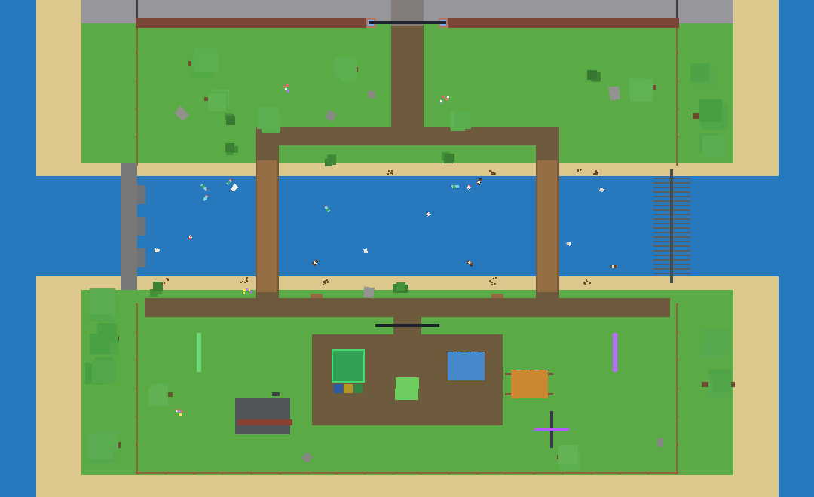

# 🌊 Чистая Река — симулятор уборки мусора для Roblox

Лови сачком мусор, который плывёт по реке, сдавай его на переработку, покупай
улучшения и открывай новые реки — от тихого ручья до морского устья.

**В игре нет доната.** Ничего нельзя купить за робуксы: ни геймпассов, ни
developer products, ни «ускорить за R$». Всё, что в других симуляторах продают за
деньги (авто-сбор, продажа из любой точки, x2 монеты, ускорение, слоты помощников),
здесь покупается за внутриигровые монеты 💰 — или просто требует подождать ⏳
(бесплатные бусты с перезарядкой, фабрика, которая копит монеты, пока тебя нет,
ежедневные награды и подарки за время в игре).



*Схема зоны «Тихий ручей» сверху (нарисована по деталям, которые строит игра).
Ещё: [Городской канал](docs/map-zone2.png), [Морское устье](docs/map-zone6.png).*

## Как запустить (самый простой способ)

1. Скачай файл [`place/ChistayaReka.rbxlx`](place/ChistayaReka.rbxlx).
2. Открой Roblox Studio → **File → Open from File…** → выбери этот файл.
3. Нажми **Play** (F5). Мир — остров с шестью реками — строится сам при запуске сервера.

### Чтобы прогресс сохранялся

Сохранения работают через DataStore, а в Studio он по умолчанию выключен:

1. **File → Publish to Roblox** (опубликуй место как свою игру).
2. **Home → Game Settings → Security → Enable Studio Access to API Services** — включи.
3. Перезапусти Play. Без этого игра работает, но предупреждает, что прогресс не сохранится.

В опубликованной игре сохранения работают сразу. Доски рекордов
(«Топ уборщиков», «Топ перерождений») заполняются тоже только в опубликованной игре;
в Studio на них видны игроки текущего сервера.

### Через Rojo (для разработчиков)

```bash
rojo serve            # и подключись плагином Rojo в Studio
# или собрать файл места заново:
rojo build default.project.json -o place/ChistayaReka.rbxlx
```

## Управление

| Действие | ПК | Телефон / планшет |
|---|---|---|
| Поймать мусор | клик по предмету (держи кнопку — сачок машет сам) | тап по предмету |
| Продать | встать на зелёную площадку ♻️ | так же |
| Магазин, помощники, фабрика… | кнопки слева или **E** у ларьков | кнопки слева или кнопка у ларька |

Если промахнулся чуть-чуть — сачок поймает ближайший к курсору предмет.
Кольцо на земле показывает дальность сачка (зелёное — достаёшь, красное мигание — далеко).

## Что есть в игре

- **6 зон**: Тихий ручей → Городской канал → Туманное болото → Промзона →
  Ядовитый канал → Морское устье. Каждая со своей темой, декорациями, цветом воды
  и туманом. Открываются по порядку за монеты; через закрытые ворота не пройти
  (сервер проверяет позицию — читерам тоже).
- **42 вида мусора** пяти редкостей (обычный → легендарный). Редкие подписаны,
  эпические и легендарные светятся. Легендарную находку видит весь сервер.
- **Сияющий мусор ✨** — случайный шанс при вылове, стоит в 5 раз дороже.
- **Мусор плывёт по течению** от труб плотины к решётке (не успел — уплыл) или
  застревает у берега. Чем больше мусора в реке, тем грязнее вода.
- **Магазин**: 10 сачков (дальность, скорость, сколько ловит за раз), 10 рюкзаков,
  7 пар обуви (скорость и прыжок), 8 перков, открытие зон.
- **Перки за монеты**: авто-сбор, водомерка (ходить по воде), продажа где угодно,
  авто-продажа, удача (10 ур.), банкир +20% монет (8 ур.), слоты помощников, склад фабрики.
- **8 помощников** (утёнок, лягушка, енот, бобр, робот, дрон, летающий кит, НЛО) —
  летают вокруг тебя и сами ловят мусор.
- **Фабрика переработки** (20 уровней) — пассивный доход, копит монеты даже когда
  ты не в игре. Улучшения строятся по времени, ускорить нельзя — только подождать.
- **5 бесплатных бустов**: x2 монеты, x2 удача, супер-сачок, бодрые помощники,
  турбо-фабрика. Включил — работает, потом перезаряжается.
- **Задания**: всегда 3 штуки (собери N, поймай редкие, заработай, сдай N раз…),
  можно заменить раз в 5 минут.
- **Ежедневная награда** (серия 7 дней, на 7-й день все бусты перезаряжаются) и
  **подарки за время в игре** (3, 8, 15, 25, 40, 60 минут).
- **Коллекция** — каждый найденный вид мусора навсегда даёт +1.5% к монетам.
- **Перерождение** — сброс ради +50% монет и +5% удачи навсегда
  (перки, помощники, фабрика и коллекция остаются).
- **События сервера** каждые 7–10 минут: мусорный шторм (мусора в 3 раза больше),
  золотой час (x2 монеты), звездопад удачи.
- **Подсказки новичку**, луч-указатель к переработке, когда рюкзак полон.
- **Сохранения** с защитой от игры на двух серверах сразу, автосохранение,
  сохранение при выходе и выключении сервера.
- Интерфейс подстраивается под размер экрана (ПК и телефоны).

## Сколько времени занимает прогресс

Расчёт симуляцией экономики (`lune run tests/economy.luau`):

| | обычный игрок | активный игрок |
|---|---|---|
| Зона 2 «Городской канал» | ~7 мин | ~4 мин |
| Зона 3 «Туманное болото» | ~34 мин | ~16 мин |
| Зона 4 «Промзона» | ~1 ч | ~43 мин |
| Зона 5 «Ядовитый канал» | ~1 ч 40 мин | ~1 ч 10 мин |
| Хватает на перерождение | ~1 ч 45 мин | ~1 ч 15 мин |
| Зона 6 «Морское устье» | ~2 ч 40 мин | ~2 ч |

Дальше — перерождения, фабрика до 20 уровня (стройка до 2 часов на уровень),
сачки за сотни миллионов и легендарки для коллекции.

## Как поменять игру под себя

Почти всё настраивается в одном файле — [`src/shared/Config.luau`](src/shared/Config.luau):
цены, награды, скорость реки, сколько мусора в реке, шансы редкостей,
длительность и перезарядка бустов, параметры фабрики, события. Там же звуки:
сейчас стоят встроенные звуки Studio, можно вставить свои `rbxassetid://…`,
а в `Music` — ID фоновой музыки.

Модели мусора и помощников собраны из обычных деталей (без внешних ассетов) —
в [`TrashModels.luau`](src/shared/TrashModels.luau) и
[`HelperModels.luau`](src/shared/HelperModels.luau). Мир строится кодом в
[`WorldService.luau`](src/server/Services/WorldService.luau).

## Устройство проекта

```
src/shared/   — общий код (ReplicatedStorage.Shared): Config, формулы, модели, геометрия реки
src/server/   — сервер (ServerScriptService.Server): 15 сервисов в папке Services
src/client/   — клиент (StarterPlayerScripts.Client): контроллеры и интерфейс
place/        — готовый файл места для Roblox Studio
tests/        — тесты и тестовый «мини-движок» Roblox для Lune
tools/, docs/ — рисование схем зон
```

Сервер — источник правды: клиент только просит («поймай предмет №…», «купи сачок»),
а сервер проверяет дальность, перезарядку, деньги и открытые зоны.
Мусор двигается по формуле от серверного времени, поэтому все видят его в одном месте,
а сеть не тратится на рассылку позиций.

## Проверки

```bash
selene src                               # линтер
lune run tests/shared.spec.luau          # формулы, модели, форматирование
lune run tests/integration.spec.luau     # вся игра целиком в тестовом движке
lune run tests/economy.luau              # симуляция экономики

# схемы зон сверху (docs/map-zone*.png)
lune run tests/mapdump.luau map.json && python3 tools/render_map.py map.json docs
```

`integration.spec.luau` запускает собранный `place/ChistayaReka.rbxlx` в тестовом
движке (`tests/engine.luau`): свойства и Enum проверяются по настоящей базе API Roblox,
а события, время, DataStore и сеть сервер↔клиент имитируются. Тест проходит игру
как игрок: заходит, ловит мусор кликом через камеру, продаёт на площадке, покупает
кнопками в магазине, открывает зону, строит фабрику, включает бусты, выполняет задания,
покупает помощника, перерождается, выходит и заходит снова (проверка сохранения),
а также проверяет режим Studio без DataStore и защиту от ловли издалека.
Настоящий Roblox Studio это не заменяет полностью — физику, рендер и вид интерфейса
стоит посмотреть глазами.
